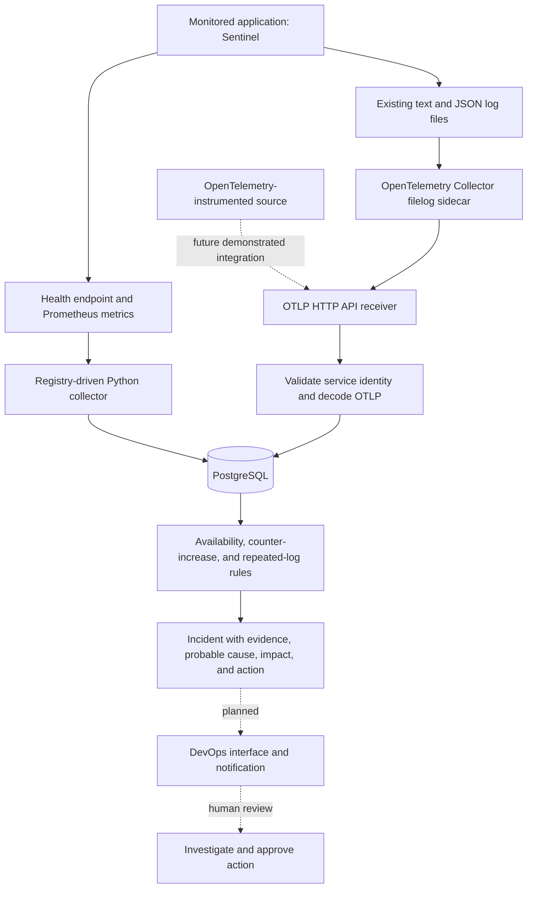

# FYP-1 Midterm Progress Report: AIOps Platform

> **Draft for adaptation.** Replace bracketed details with the student's
> actual information. Refresh incident status and table counts before
> submission. The draft describes only implemented or observed work; it does
> not claim ML, RAG, LLM diagnosis, notifications, or a frontend are complete.

**Student(s):** [Names and student IDs] 
**Supervisor:** [Name] 
**Programme / Department:** [Programme] 
**Submission date:** [Date] 
**Work distribution:** [Add each member's actual contribution]

## Chapter 1: Introduction

### 1.1 Overview

Software services produce operational information through health checks,
metrics, logs, and traces. Health checks indicate whether a service responds
to a probe. Metrics describe numerical behaviour over time, logs record
individual events, and traces show the path of a request through components.
When these signals are separated across tools, an operator may need to search
multiple places and manually connect an alert with the evidence that explains
it.

This project is developing an application-agnostic Artificial Intelligence
for IT Operations (AIOps) platform. AIOps is the main project. Sentinel is the
first separate application connected as a monitored target; it is not part of
the AIOps platform. The platform reads telemetry through documented
interfaces and does not import or modify Sentinel's source code. Service
connection details, metric allow-lists, and detection guidance are declared
in a YAML registry.

The current implementation includes a FastAPI backend, PostgreSQL database,
registry-driven Python collector, OTLP/HTTP protobuf receiver, and an
OpenTelemetry Collector sidecar for Sentinel log files. The collector checks
Sentinel's `/health` endpoint and scrapes its Prometheus-format `/metrics`
endpoint. The sidecar reads Sentinel's mounted plain-text and JSON event
files and forwards records to AIOps using OTLP. PostgreSQL stores service
records, metric samples, readable log records, incidents, raw OTLP batches,
and a table reserved for future fault labels.

The detection stage currently uses explicit rules. Failed health or metrics
checks can create availability incidents. A counter-increase rule detects a
rise in Sentinel's operational-error metric. A log rule requires at least
three `ERROR` or `FATAL` records in a five-minute window. An incident contains
observed evidence, a probable cause, possible user impact, and a recommended
investigation. These statements remain uncertain when the available signal
does not prove the underlying cause or user impact.

During the latest observed run, the repeated-error rule opened incident 5
after Sentinel logs repeatedly reported failed ACLED fetch attempts. This
identifies the affected operation but does not establish why those requests
failed. A separate availability incident followed a collector-to-Sentinel
network failure; subsequent health and metrics probes from inside the
collector returned HTTP 200. Refresh incident status before submission,
because it changes as new telemetry arrives.

The midterm result is a working prototype of telemetry collection, storage,
and initial rule-based detection. A graphical dashboard, DevOps
notifications, broad root-cause ranking, trained ML, RAG, and LLM diagnosis
are future work. The current focus is to establish and evaluate transparent
baselines before expanding to model-based analysis.

### 1.2 Project Motivation

The project is motivated by the difficulty of diagnosing service problems
from fragmented operational signals. An error counter may show that errors
increased, while a log may identify an affected component. A health probe may
show whether the target responds from the collector's network location.
These signals are useful, but none automatically provides a complete
explanation. A failed collector probe could mean the application is down,
the dependency failed, the URL is wrong, or the network path is broken. A
log can report a failed operation without proving users were affected.

The platform therefore aims to turn available telemetry into an incident
record that preserves evidence and helps an operator investigate. Each
incident should state what condition was observed, provide relevant metric
samples or log records, give a probable cause with appropriate uncertainty,
describe possible user impact, and recommend a next investigation step.
The system assists an operator; remediation remains human-approved.

Interoperability is another motivation. Applications expose different
metrics and log formats. A platform tied directly to one application's code
would be difficult to reuse. The project separates common collection and
rule evaluation from service-specific registry configuration. It uses
Prometheus scraping for pull-based metrics and OTLP as a standard push path
for OpenTelemetry signals. Prometheus represents measurements as
time-series samples, while OpenTelemetry provides vendor-neutral APIs and
collection/export components [1, 2].

The project also needs an incremental evaluation path. Threshold rules are
transparent and can be compared with controlled scenarios before adding
machine learning. A measured increase in `sentinel_ops_errors_total` proves
that the counter changed over the configured time window; it does not alone
prove which dependency failed. The incident model preserves that distinction
so the platform does not present a measured symptom as a guaranteed cause.

### 1.3 Project Vision, Scope, and Glossary

**Vision.** Build an application-agnostic AIOps platform that receives
operational signals, detects issues in those signals, creates evidence-backed
incidents, describes probable causes and likely user-impact risks, recommends
investigation steps, and eventually notifies DevOps. Any action that changes
a monitored service remains subject to human approval.

**Current scope.** Implemented work includes service registration, health and
Prometheus metric collection, OTLP/HTTP log ingestion, raw payload retention,
normalized log storage, availability checks, a metric counter-increase rule,
and a repeated-error log rule. Sentinel is the only connected application
demonstrated so far. The service registry is designed for additional targets,
but second-application portability has not yet been demonstrated.

**Outside the current implementation.** No graphical dashboard, notification
integration, automatic remediation, broad causal ranking, trained ML model,
RAG knowledge base, or LLM diagnosis has been completed. The `/ops/events`
endpoint on Sentinel returns 404; its mounted files are forwarded through a
separate Collector configuration.

| Term | Meaning in this project |
|---|---|
| AIOps | The platform being built to collect and analyze operational telemetry. |
| Monitored service | An application registered with AIOps; currently Sentinel. |
| Prometheus scraping | AIOps periodically pulls metric samples from `/metrics`. |
| OTLP | OpenTelemetry Protocol used to push telemetry to the AIOps API. |
| Incident | A record created when a configured detector observes a condition. |
| Probable root cause | A hypothesis supported by available evidence, not a guarantee. |
| Fault label | Ground-truth record for a controlled fault scenario. |

### 1.4 Objectives

1. Design an AIOps platform that reads monitored applications through
   external telemetry interfaces, without importing their code.
2. Register target endpoints, metric allow-lists, and detection guidance
   outside the collector's general logic.
3. Collect health results and Prometheus metrics and store them in PostgreSQL.
4. Accept OTLP/HTTP protobuf batches and preserve their original payloads.
5. Normalize OTLP logs from registered services into queryable records.
6. Detect availability failures, configured counter increases, and repeated
   error-level logs using transparent rules.
7. Attach evidence and express causes and user impact as probable or possible
   when the evidence does not establish certainty.
8. Evaluate detectors with controlled scenarios before introducing ML, RAG,
   or LLM diagnosis.
9. Add incident acknowledgement, notifications, a user interface, further
   service integrations, and deployment hardening in later stages.

### 1.5 Tools

The backend uses Python 3.11, FastAPI, and Uvicorn. PostgreSQL 16 stores the
platform data. `psycopg2-binary` provides database access. The API uses
`opentelemetry-proto` and `googleapis-common-protos` to decode OTLP protobuf.
The collector uses PyYAML for the service registry and a Prometheus text
parser for scraped samples. The file-log sidecar uses OpenTelemetry Collector
Contrib 0.165.0. Docker Compose orchestrates the local containers, and
PowerShell is used to operate them on the Windows development computer. These
are the tools used in the prototype; production deployment is future work.

### 1.6 Problem Statement and Project Questions

The practical problem addressed in this project is that an operator may
receive separate signs of a service problem without a concise record that
connects the observed condition to its evidence and next investigation step.
For example, a rising counter can indicate that new operational errors
occurred, but it may not identify the component that failed. A log may name
an affected source, but it may not explain whether the cause was a timeout,
credentials, rate limiting, or a remote service outage. A failed health probe
may describe the connection from the collector's perspective rather than the
experience of every end user. A useful AIOps prototype therefore needs to
preserve the observations, distinguish symptoms from hypotheses, and avoid
claiming more certainty than its data supports.

This work is guided by three practical questions. First, can an external
collector connect to a separately deployed application through common health,
Prometheus, and OpenTelemetry interfaces without integrating the application's
source code into the AIOps backend? Second, can the platform store telemetry
and create an incident whose evidence can be inspected after detection?
Third, how should a rule describe a likely cause and possible impact when the
available evidence is incomplete? At midterm, the implementation demonstrates
an initial answer to the first two questions for Sentinel and a cautious
incident format for the third. It does not yet demonstrate broad portability
across applications or a measured root-cause accuracy score.

### 1.7 System Boundary and Expected Contribution

The AIOps boundary begins with telemetry exposed by or exported from a
monitored application. A registry entry describes where the collector can
reach the service, which metric names it should retain, and what configured
rules mean for that service. The collector or OTLP receiver passes observations
to the AIOps backend. The backend stores them and creates incidents when a
detector condition is met. A DevOps operator then uses the evidence to decide
what to investigate. The current prototype implements collection, persistence,
and the first detector types in this flow; it does not yet provide the complete
operator interface or a notification channel.

The intended contribution at this stage is a modular, inspectable starting
point for multi-signal incident detection. It separates common collector
behavior from Sentinel-specific configuration, preserves raw OpenTelemetry
batches, normalizes logs for queries, and stores structured incident
evidence. This is a software engineering and evaluation contribution rather
than a claim that an autonomous system can already predict outages. The future
research contribution will depend on a documented set of controlled scenarios,
ground-truth labels, and evaluation measures. That evidence is needed before
making claims about precision, recall, detection delay, or root-cause ranking.

The expected users are DevOps or operations personnel who need a compact
starting point for investigation. The platform is not intended to replace
existing monitoring tools, application owners, or incident command processes.
It can consume signals from those systems and help connect selected evidence.
Its value depends on signal quality, correctly configured service identity,
network reachability, suitable retention, and detector rules that are tested
against representative conditions. If an application exports no useful
telemetry, the platform cannot reliably infer hidden user-facing failures.

### 1.8 Success Criteria, Assumptions, and Constraints

For the current prototype, success is assessed through observable behaviors.
The API should start with its database dependency, expose a health route,
and accept the documented OTLP signal requests. The collector should load
service configuration without application-specific branching, reach the
registered Sentinel endpoints, and store only the configured metric names.
The file-log forwarder should preserve source time and service identity while
shipping both supported log formats. When a configured rule condition is
met, the platform should create a persisted incident with enough evidence
for a person to reproduce why it fired. When evidence is ambiguous, the
incident wording should make that ambiguity visible. These criteria are
verifiable from API responses, container logs, and database queries.

The longer-term project goals require stronger acceptance criteria. A
second independent application should be connected by adding a service
configuration and compatible exporter or adapter settings, without embedding
its application code in the AIOps platform. Controlled scenarios should
measure whether detectors catch known problems and whether normal operation
produces unnecessary incidents. A future diagnostic component should be
evaluated against labeled causes and should provide evidence references.
Notifications should deliver the incident context to an operator and record
acknowledgement or disposition. These goals are not counted as midterm
successes until there is an implementation and repeatable demonstration.

The design assumes that a monitored application can provide a stable
service identity, timestamps, and at least one usable signal. It assumes
that the AIOps host can route to the service or mount an existing log
directory. It assumes that database credentials and exporter endpoints are
configured securely outside checked-in source files. It does not assume that
all applications expose the same metrics, that a health endpoint measures
every dependency, or that a metric threshold directly describes user
experience. These assumptions constrain the claims that can be made from a
single Sentinel integration.

Important project constraints are time, access to the monitored application,
and the availability of repeatable fault scenarios. The existing Sentinel
application provides a realistic first target, but its observed ACLED fetch
errors depend on an external data source and may not be repeatable on demand.
Network changes can also cause collection failures unrelated to Sentinel
itself. For a fair detector evaluation, the project must control or record
these external conditions and differentiate target failure from telemetry
transport failure. The prototype currently runs in a local development
environment and has not been assessed for high availability, production
load, long-term retention cost, role-based access, or multi-tenant security.

The software is designed to provide diagnostic assistance, not autonomous
authority over monitored applications. Incident recommendations are
investigation suggestions. Any future remediation integration should show
the action, affected target, supporting evidence, and expected effect, and
should require an explicit human decision. This boundary is important to the
project's vision because an incorrect automated change could increase the
impact of an incident. At midterm, the system does not execute actions, and
the defense should describe that as a deliberate future boundary rather
than implying that automated response already exists.

## Chapter 2: Background Study and Literature Review

### 2.1 Introduction

Modern software is operated through a combination of monitoring, telemetry
collection, alerting, and human investigation. These activities generate
different kinds of evidence: metrics summarize numerical behavior, logs record
discrete events, traces represent request paths, and health checks report a
service's response to a probe. AIOps research seeks to use data analysis and
automation to assist operational work, including anomaly detection, incident
triage, and root-cause analysis. The term covers a broad set of tasks rather
than a single algorithm or product category. Surveys of AIOps describe a
research area that combines operational data, machine learning, and software
operations, while also identifying challenges around data quality,
heterogeneous telemetry, evaluation, and deployment [3, 4].

This chapter reviews the techniques most relevant to the current prototype.
It begins with conventional observability and telemetry standards, then
examines log parsing, rule-based detection, machine-learning approaches,
multisignal incident analysis, and evaluation. It distinguishes deployed
capabilities in this project from ideas considered for later stages. In
particular, the reviewed machine-learning and language-model methods are
background for future research; they are not components of the current
incident detector.

### 2.2 Monitoring and Observability Signals

Traditional monitoring often begins with defined questions about a system:
whether a process is responding, whether resource use exceeds a limit, or
whether an error counter has changed. Monitoring is useful when operators
know which signals to collect and which conditions merit attention. It can
also miss issues that were not anticipated when dashboards and alerts were
configured. Observability is commonly used to describe the ability to
investigate internal behavior from emitted outputs, especially metrics, logs,
and traces. These signal types have different structures and are often most
useful when correlated.

Metrics are numeric measurements associated with names, timestamps, and
optional labels. They are efficient for evaluating trends and thresholds.
Counters represent cumulative increases, gauges represent values that may
rise or fall, and histograms summarize distributions such as request duration.
Prometheus uses a pull model in which a server scrapes instrumented targets
over HTTP and stores labeled time series. Its official documentation explains
the data model and scrape-based collection, and also describes alerting and
service discovery as parts of the wider monitoring ecosystem [1]. In this
project, AIOps runs a registry-driven scraper and requests Sentinel's
`/metrics` endpoint every 30 seconds. The registry's `metric_names` list
limits which sample names are saved. This provides a small and understandable
baseline, although the collector currently implements a deliberately narrow
subset of metric semantics.

Metric interpretation requires care. A counter sample of 10 followed by 12
shows an increase of two within the observation interval, assuming the
counter was not reset or the target restarted. It does not automatically
explain the cause of the increase. A single sample cannot establish a rate or
trend, and gaps in scraping can hide short-lived behavior. Labels provide
context, but labels with unbounded values can create excessive time-series
cardinality. A production platform must therefore define collection
intervals, allowed metric names, label policy, retention, counter-reset
handling, and rules for stale or missing data.

Logs are event records, often containing a timestamp, severity, message, and
structured attributes. They can identify a particular operation or
dependency that aggregate metrics do not name. However, log text is
application-specific, can change between releases, and may contain sensitive
information. Unstructured text also makes exact matching brittle. The AIOps
prototype receives Sentinel's existing plain-text and JSON event files via an
OpenTelemetry Collector filelog sidecar. The sidecar parses timestamps and
severity, then exports the records using OTLP/HTTP. The API retains original
OTLP batches and normalizes log records from registered services into
PostgreSQL. A log-rule detector uses severity and a five-minute occurrence
window; it attaches matching records as evidence. This is an interpretable
counting rule, not a learned log anomaly detector.

Distributed traces represent spans and relationships in a request or
operation path. They can help identify which component contributed latency
or failure when a request traverses multiple services. Trace analysis depends
on instrumentation, context propagation, sampling, and consistent service
identity. Although the API accepts OTLP trace batches and preserves raw
payloads, the project has not yet demonstrated normalized trace storage,
trace-based correlation, or tracing from Sentinel. Consequently, no current
incident should claim that a trace established its root cause.

### 2.3 Prometheus and OpenTelemetry Interoperability

Prometheus and OpenTelemetry solve related but different interoperability
needs. Prometheus defines a widely used metric exposition and collection
ecosystem based on scraping. OpenTelemetry (OTel) is a vendor-neutral set of
APIs, SDKs, semantic conventions, and collectors for generating, processing,
and exporting telemetry. The OpenTelemetry project explicitly does not define
a storage backend; telemetry must be exported to a compatible destination
[2]. OTLP is the protocol by which OpenTelemetry signals can be transported.
This separation allows an application to emit standard telemetry while a
backend chooses its own persistence and analysis model.

The AIOps design supports both a pull path and a push path. The pull path
requests health and Prometheus metrics from targets configured in the service
registry. The push path exposes OTLP/HTTP protobuf endpoints for traces,
metrics, and logs. Raw request bodies are stored in `otel_payloads`; OTLP logs
are also normalized into `logs`. Supporting multiple ingestion approaches is
useful because an external app may already expose Prometheus metrics, may be
instrumented with an OpenTelemetry SDK, or may need an OpenTelemetry Collector
to translate and forward existing logs. The currently demonstrated Sentinel
setup uses Prometheus scraping for metrics and the Collector filelog receiver
for logs. It has not demonstrated that arbitrary external applications can
connect without configuration changes, because each app still needs reachable
endpoints, a registered identity, compatible telemetry, and a suitable
registry entry.

The OpenTelemetry Collector can receive, process, and export telemetry using
configurable pipelines. This project uses its filelog receiver and OTLP
exporter as an adapter between Sentinel's existing log files and the AIOps
API. Separate receivers are configured for plain-text logs and JSON-lines
events because their parsers differ. Source timestamps should be preserved:
using file collection time for old records could make historical errors look
new and cause false detections. A documented decision in this repository
records the use of separate format-specific receivers and timestamp parsing.

Interoperability does not itself guarantee semantic compatibility. Two
applications can emit a metric with similar names but different units or
aggregation meaning. Service names may not match registry names. Log severity
vocabularies and timestamps may differ. Therefore the project documents a
telemetry contract covering required endpoints, expected identity, canonical
metric meanings, event fields, and OTLP routes. For a general-purpose product,
the contract would need versioning, validation, compatibility handling, and
clear onboarding guidance. The current contract is a design baseline for the
prototype and has not been validated against a diverse set of applications.

### 2.4 Rule-Based Detection and Incident Management

Rules are a common starting point for operational alerting because their
conditions can be inspected and communicated. A rule can specify a threshold,
a duration, or an increase relative to a prior observation. If the monitored
condition is explicit, an operator can understand why it fired. Rules are
also useful as baselines for later comparison with statistical or machine
learning detectors. Their principal drawback is that thresholds require
domain knowledge and maintenance. A static limit may be too sensitive during
normal workload variation, or too permissive for a service whose normal range
changes over time.

The current prototype uses three rule families. An availability rule records
failed health or metrics checks and later attaches recovery evidence when
both probes succeed. A metric rule calculates whether a configured counter
increased over the lookback window. A log rule opens an incident when the
configured number of matching severities occurs within a window. For each
rule, the registry includes a severity, title, probable-cause wording,
impact assessment, and recommended investigation. This approach keeps
service-specific interpretation in configuration rather than hard-coding
Sentinel names into the general detector.

An incident is more useful than a bare alert when it keeps the condition,
evidence, state, and subsequent recovery together. Incident lifecycle
management can include creation, acknowledgement, assignment, escalation,
resolution, and post-incident review. The project currently persists incident
records and can resolve some availability incidents after successful
recovery checks. It has no acknowledgement workflow, operator assignment,
notification integration, or dashboard yet. A resolved record means the
configured detector condition no longer appears active according to its
current rule; it does not prove that an underlying business problem was fixed.

Evidence quality is central to root-cause communication. If a scrape fails,
the platform can report that it could not reach the metrics endpoint from the
collector. It should not automatically claim that the application process is
down, because routing, DNS, firewall, endpoint configuration, or a transient
network issue could also explain the observation. If Sentinel's log says an
ACLED request failed after retries, that supports the claim that the fetch
operation encountered errors; it does not identify whether credentials,
remote availability, rate limiting, or another condition was responsible.
The incident schema therefore distinguishes a measured symptom from a
probable cause and possible user impact. Confidence should be calibrated
against evaluation data before being interpreted as a probability.

### 2.5 Log Parsing and Log-Based Anomaly Detection

Operational log analysis has two related tasks: parsing message structure
and identifying unusual or important behavior. Log parsing converts
semi-structured messages into templates and variable parameters. He et al.'s
Drain method uses a fixed-depth parse tree and similarity rules to group log
messages into templates, and was evaluated on multiple system log datasets
[5]. Template mining can help downstream models count event patterns without
treating every variable value as a new message. However, parser accuracy can
decline when formats change, when messages are highly diverse, or when a
parser is applied to logs outside its assumptions. Parsing also does not
decide whether a message indicates a user-facing incident.

The current AIOps implementation takes a narrower path because Sentinel logs
already contain parsable timestamp and severity conventions. It preserves the
message and metadata in a normalized database record and selects `ERROR` and
`FATAL` entries for the repeated-error rule. This is intentionally
transparent: operators can inspect the records that satisfied the count. It
does not create a universal parser for arbitrary application logs. A second
app with a different format would require a suitable receiver/parser
configuration or structured OTLP logging.

Machine-learning approaches can model normal log sequences or detect unusual
templates. LogBERT, for example, applies a bidirectional encoder
representation to log sequences and evaluates anomaly detection using
benchmark datasets [6]. Such methods may capture dependencies that simple
counts miss, but their effectiveness depends on representative training data,
preprocessing, stable event representations, and an evaluation protocol that
avoids leakage between training and test sequences. A model can also mark a
novel but harmless release message as anomalous, or miss a dangerous event
that resembles normal data. The existence of a published model does not
establish that it will work on Sentinel's logs without experimentation.

The FYP proposal includes later interest in ML, retrieval-augmented
generation (RAG), and large language models (LLMs). For log diagnosis, ML
could eventually rank anomalies or patterns. RAG could retrieve relevant
runbooks or prior incidents, and an LLM could summarize evidence into an
operator-facing explanation. These components introduce additional risks:
training data may be sparse or imbalanced, retrieved documents may be stale,
and language models may produce unsupported causal explanations. Any future
assistant should cite the telemetry or retrieved runbook that supports its
recommendation and explicitly allow an “insufficient evidence” response. At
midterm, these remain planned research directions and have not been
implemented or evaluated.

### 2.6 Machine Learning for AIOps and Root-Cause Analysis

AIOps research applies statistical learning and artificial intelligence to
operational tasks such as anomaly detection, event correlation, diagnosis,
and remediation. A systematic survey of AIOps and machine-learning
operations literature discusses the relationship between model development
and operational deployment, and highlights the need to monitor data and model
behavior over time [4]. A broader 2025 survey considers AIOps in the context
of large language models, reflecting recent interest in natural-language
interfaces and agentic workflows [3]. These surveys emphasize that a
successful operational system is not simply a model: data collection,
context, action boundaries, feedback, and evaluation are all part of the
problem.

Anomaly detection methods vary from fixed thresholds to statistical
forecasting, clustering, and neural models. Thresholds offer direct
explanations but may not adapt to seasonality. Statistical methods can model
expected ranges but need stable histories and appropriate assumptions.
Supervised classifiers need labeled examples of normal and faulty behavior,
which are often expensive to obtain. Unsupervised techniques reduce reliance
on labels but can return clusters or anomaly scores that are difficult for an
operator to interpret. Neural sequence models may represent temporal
patterns, but commonly require more data and careful deployment. These
tradeoffs motivate beginning with deterministic rules and building a
repeatable evaluation set before deciding whether a learned model improves
the outcome.

Root-cause analysis is more demanding than anomaly detection. Detection asks
whether a signal differs from an expected condition. Diagnosis asks which
component or dependency produced the condition and what evidence supports
that explanation. A correlation between a metric and an error log can narrow
the search, but correlation alone does not establish causation. Dependency
graphs, traces, deployment events, topology, and historical incident labels
can improve diagnosis, but each requires reliable context. The project does
not yet have a dependency graph or a validated causal model. Its current
probable-root-cause fields contain rule guidance and evidence-aware language,
not results from a causal inference algorithm.

Potential user impact assessment is also distinct from root-cause analysis.
Telemetry may indicate that a pipeline stage failed or a service is
unreachable, but determining affected users may require request-level
success rates, traffic, service-level objectives, and business context. A
reasonable early system can describe conditional impact (“if this persists,
requests may fail”) and say when impact is unconfirmed. A prediction that
users will experience a specific outcome needs an evaluation basis and
appropriate customer-facing telemetry. The current platform does not infer
user counts, forecast outage duration, or predict future incidents.

Recent LLM-oriented AIOps work explores natural-language understanding,
knowledge retrieval, and tool-using agents. AIOpsLab proposes a framework for
studying AI agents in cloud operations with tasks and environments intended
to support holistic evaluation [7]. This line of work illustrates the value
of testing an agent on operational tasks rather than judging only the
fluency of its answers. It also reinforces the need for controlled
environments and safe action boundaries. For this FYP, any future LLM
recommendation must remain advisory, be grounded in stored evidence and
approved operational documents, and be reviewed by a human. Automatic
remediation is outside the current implementation and should not be implied
in the defense.

### 2.7 Datasets, Ground Truth, and Evaluation

Evaluation is difficult because operational incidents are relatively rare,
labels are incomplete, and the same service behavior can differ across
workloads and environments. Public log datasets can support experiments on
parsing or anomaly detection, but they may not represent the target
application, deployment configuration, or failure modes. A result on a
benchmark cannot by itself establish effectiveness on a different system.
For this project, telemetry collected from Sentinel is the initial
application dataset. It consists of metric samples, normalized logs, raw
OTLP payload metadata and payloads, and generated incident records. It is a
project-specific operational dataset, not a prepared public dataset with
ground-truth labels for every interval.

The database contains a `fault_labels` table intended to associate controlled
experiments with labels and a `run_id`. Its presence in the schema should not
be presented as evidence that a labeled dataset or model training has already
been completed. Before a formal ML experiment, the project should define
fault scenarios, record exact start and end times, label affected services
and components, preserve normal baseline runs, and document what telemetry
each scenario is expected to change. Scenarios should be repeatable and
isolated so that each label has a clear meaning.

If a future model is trained from time-dependent telemetry, splitting
individual rows at random can place adjacent samples from the same incident
in both training and test sets. This would leak temporal and event context
and produce an overly optimistic result. A more defensible initial approach
is to split by complete experiment `run_id`, with training, validation, and
test runs separated. Where practical, runs should also be separated by time
or scenario variants so the test set checks generalization. The existing
decision log records the intention to split by complete run rather than
random rows. However, no model has been trained, and no actual train,
validation, and test partitions currently exist. The report should state
this clearly and ask the supervisor whether the required dataset-split
subsection may describe the planned protocol until the ML phase begins.

For the current rule-based prototype, evaluation should focus on detector
behavior rather than ML metrics. A controlled test matrix can measure whether
each detector fires under a defined injected condition, remains quiet under
normal operation, attaches the expected evidence, and transitions status
correctly after recovery. Useful measures include detection latency, true
positive and false positive counts over labeled runs, incident duplication,
evidence completeness, and whether the generated cause statement exceeds
the evidence. Rule outcomes should be compared to a human-maintained ground
truth. These controlled evaluations remain future work; the live Sentinel
incident is an integration demonstration, not a statistically sufficient
evaluation.

### 2.8 Limitations of Existing Approaches and the Project Gap

Each signal and technique has limitations. Health probes cover only the
probe's route and checks. Metrics aggregate behavior and can hide individual
failures. Logs are detailed but inconsistent and may omit context. Traces
provide request paths but require instrumentation and introduce sampling
tradeoffs. A collection system can lose data when exporters, networks, or
storage are unavailable. A common protocol improves transport compatibility,
but not the meaning or quality of an application's signals.

Rule-based detectors are understandable but static. Their quality depends
on thresholds, lookback windows, sample frequency, source reliability, and
correct handling of counter resets and stale data. A rule can fire repeatedly
if incident deduplication is weak, and an incident may remain open after a
signal recovers if lifecycle logic is incomplete. The prototype's initial
rules cover availability, one Sentinel counter, and repeated log severities;
they do not cover every user-impacting issue. Current status and historical
incident records should be interpreted with their evidence and timestamps.

Machine-learning detectors can model complex patterns, but they need data,
labels or robust anomaly baselines, monitoring for drift, and careful
evaluation. Their output may be less transparent than explicit rules. LLMs
can create readable summaries but can generate plausible unsupported
explanations; retrieval can help only if source documents are current and
relevant. Neither approach eliminates the need for reliable telemetry,
ground-truth evaluation, and human review.

The identified project gap is a practical, modular prototype that can accept
more than one telemetry path, keep service-specific settings outside its
general collector, preserve evidence, and create cautious incident records.
The implementation addresses an initial portion of this gap with Sentinel.
The following claims are not yet supported: that it works with any
application without adaptation; that it detects every class of user issue;
that the probable cause is always correct; that the risk assessment predicts
future impact; or that ML, RAG, or LLM analysis improves results. Demonstrating
portability requires integrating at least one additional independent app.
Demonstrating detector quality requires controlled scenarios and labels.
Demonstrating user impact requires telemetry tied to requests or service
objectives. These tasks shape the remaining work.

There is also an integration gap between research prototypes and the needs of
an operational team. A detector may report strong benchmark performance but
still require custom data preparation, labels, or knowledge that is not
available during a real incident. Conversely, a system that integrates
reliably and explains its evidence may be useful before it has sophisticated
prediction. This project therefore treats connectivity, persistence, and
evidence inspection as explicit milestones alongside detection. The current
Sentinel integration provides an end-to-end example, but it has not yet been
tested with a second application's metric naming, log format, identity, or
failure patterns. Generality remains a design goal that needs a portability
experiment.

The same care applies to storage and security. Telemetry can include
operational details, identifiers, stack traces, and occasionally sensitive
values. A production deployment needs access control, transport security,
retention and deletion policies, audit logging, and protection of secrets.
It should also control payload size and label cardinality to prevent
unbounded storage or resource use. The prototype applies a request-size
limit and uses environment-based configuration, but it has not undergone a
security audit, multi-user access-control implementation, or production load
test. These are engineering limitations that affect operational readiness
even when a detector's logic is correct.

### 2.9 Incident Correlation and Explainability

Individual alerts often describe one metric, log pattern, or failed probe.
During a wider service incident, many alerts may be caused by one underlying
event. Correlation attempts to group related signals by time, service,
component, dependency, or known topology. Effective correlation can reduce
duplicate pages and help an operator move from symptoms toward a likely
fault domain. Poor correlation can merge unrelated events or hide a second
failure, so the grouping criteria need to be inspectable and evaluated.

The simplest correlation is temporal: observations from the same service
within a defined interval are considered together. More advanced approaches
can use traces, dependency graphs, deployment history, and causal structure.
Temporal proximity is not proof of shared cause, especially in a busy system
where unrelated failures happen close together. A dependency graph can
provide useful context, but only if service relationships are current and
the telemetry can be mapped to those components. The AIOps prototype does not
yet implement cross-signal correlation. Its metric and log rules are
evaluated independently, and evidence is attached to the incident created by
each rule. A future correlation stage should preserve which observations
were grouped and why, rather than replacing them with an opaque summary.

Explainability in this context means that an operator can inspect the input
condition and follow how the detector reached its output. For deterministic
rules, the explanation can include the metric values and delta, matching log
records and timestamps, or the probe endpoint and error. This is a practical
advantage of the current baseline. But readable rules alone do not guarantee
that the rule is correct: the selected window and threshold can still be
inappropriate, and a clear explanation can still describe a false positive.
Explainability should therefore be paired with controlled tests and a
record of detector configuration.

Cause and impact language should also distinguish evidence from inference.
An incident can state “the collector received three error-level records
about ACLED fetch failures” as an observation. “The remote data provider is
unavailable” would be a stronger causal claim and requires additional
evidence. “If failures continue, pipeline output may be delayed” is a
conditional impact assessment; it is not a measured user impact. A useful
incident report can expose confidence boundaries by naming what is known,
what remains uncertain, and what evidence would help narrow the cause. The
current registry guidance is written to preserve that separation, but the
project has not measured whether operators find the wording useful or whether
they reach a correct diagnosis faster. User evaluation is a future activity.

Human feedback can improve incident systems when it is captured consistently.
An operator may confirm or reject a proposed cause, mark an alert as
non-actionable, or record the action that restored service. Such feedback
could become labels for later experiments, but only if labels have clear
definitions and are not automatically treated as ground truth. People may
disagree, or a service can recover without revealing the original cause.
The current schema includes a `fault_labels` table for controlled scenarios,
but it has not yet implemented a complete feedback workflow. Adding
acknowledgement and resolution context should be accompanied by an audit
trail, ownership policy, and distinction between detector state and human
resolution.

### 2.10 Operational Data Quality and Alert Fatigue

Operational telemetry is produced by software built for a different primary
purpose than research. Its fields may be missing, delayed, duplicated, or
inconsistent after a deployment. Instrumentation can change over time, and a
service may emit much more data during an incident than during normal
operation. A model trained on earlier versions can therefore encounter
schema drift or a new baseline. Missing data is also ambiguous: it may mean
that the service is quiet, that a collector stopped, that the network path
failed, or that storage rejected a batch. A robust platform needs to monitor
its own collection pipeline so that absence of telemetry is not silently
treated as healthy service behavior.

Alert fatigue occurs when operators receive too many low-value or duplicate
notifications and begin to ignore them. A detector's practical value depends
not only on whether it can identify a fault, but also on how often it raises
false or repeated alerts, whether an alert includes useful context, and how
quickly an operator can determine what to do. Grouping signals into incidents,
using severity consistently, suppressing duplicates, and recording recovery
can improve usability. Suppression must be applied carefully so that a new
or worsening fault is not hidden behind an existing incident. The prototype
currently creates incidents from initial rule conditions and includes
availability recovery handling, but it does not yet provide a complete
deduplication policy, notification policy, or operator feedback cycle.

These issues are also why data retention and raw payload preservation matter.
Keeping original OTLP batches makes it possible to inspect what the source
sent and to add a later decoder without losing the original request. Normalized
rows make routine queries and rule evaluation easier, but the normalization
process itself can omit unsupported attributes or reveal malformed data.
Maintaining both forms improves auditability at a storage cost. For a
production system, retention duration, sensitive-field treatment, payload
limits, schema migration, backups, and deletion requests must be addressed.
At midterm the platform demonstrates raw OTLP storage and normalized logs,
but it has not established a production retention policy or measured storage
growth at realistic scale.

### 2.11 Summary

The literature and tooling establish a staged path for this project.
Prometheus scraping and OpenTelemetry/OTLP provide complementary mechanisms
for metrics and telemetry transport. Structured log parsing can make records
queryable, while explicit rules provide an understandable baseline. Research
on log models, AIOps, and LLM-based operations suggests future options, but
also highlights data, generalization, explainability, and evaluation
challenges. Accordingly, the current midterm contribution is a running
telemetry ingestion and evidence-backed rule prototype, while causal
diagnosis, predictive impact, ML, RAG, LLMs, and broad application coverage
remain research and implementation goals.

## Chapter 3: Methodology

### 3.1 Research and Development Approach

The project follows an incremental prototype-and-evaluate approach. The
first stage establishes the AIOps service boundary, database, API, and local
container deployment. The second stage connects a real monitored application
through health and Prometheus interfaces. The third stage introduces
standardized OTLP ingestion and a file-log adapter, then adds explicit rules
that turn observations into incident records. This ordering allows each
pipeline boundary to be inspected before adding more complex analysis.

At midterm, the implemented detector is deterministic and configuration
driven. Its conditions can be reviewed in the registry, and the stored
incident contains the observations that caused the rule to fire. The next
evaluation stage should add repeatable controlled scenarios and ground-truth
labels. Only after a baseline is measured should the project decide whether
an ML method improves detection or diagnosis. RAG and LLM assistance are
later project phases and are not part of the current method.

### 3.2 System Flow Chart

The current and planned system path is represented below. The solid portion
corresponds to implemented collection, persistence, and initial detection.
Incident display and notification are planned extensions. Detection outputs
remain subject to operator review.

The flow separates transport from detector logic. The Prometheus collector
pulls metrics, while the sidecar pushes logs through OTLP/HTTP. Raw accepted
OTLP request bodies are retained in `otel_payloads`. Log records are
normalized into `logs` for detector queries. Metric samples and incidents
are stored in their own tables. The detector reads observations over a
configured time window and writes an incident that includes relevant
evidence. In the future, the incident interface can present the record and
send a notification, but those components are not yet implemented.

A standalone, presentation-ready version of this architecture diagram is
available in [architecture-diagram.md](architecture-diagram.md).

### 3.3 Dataset and Data Sources

The current dataset is telemetry generated by the connected Sentinel
application and the AIOps platform. It is collected during normal operation
and during naturally occurring failures. It is not a static CSV benchmark
and it does not yet contain complete ground-truth labels. Its principal
sources and stored representations are:

| Source | Collection path | Stored form | Current use |
|---|---|---|---|
| Sentinel health endpoint | Collector HTTP request to `/health` | Health result and incident evidence | Availability rule |
| Sentinel Prometheus metrics | Collector HTTP scrape of `/metrics` | Allow-listed metric samples with labels and collection time | Availability and counter-increase rules |
| Sentinel plain-text logs | Mounted files read by Collector filelog receiver | Raw OTLP batch plus normalized log rows | Repeated-error rule and incident evidence |
| Sentinel JSON event files | Separate filelog receiver and JSON parser | Raw OTLP batch plus normalized log rows and parsed event fields | Operational investigation and log detection |
| OTLP traces and metrics | API routes `/v1/traces` and `/v1/metrics` | Original accepted payloads and metadata | Ingestion capability; not yet normalized for analysis |
| Detector output | Rule evaluation over stored observations | `incidents` rows with severity, status, explanation, and evidence | Incident review |

The project's database schema also includes `services` and `fault_labels`.
The `services` table represents registered monitored applications in the
database. `fault_labels` is reserved for ground truth associated with
controlled scenarios and includes a run identifier. At this reporting
point, the schema exists but a formal, labeled experiment dataset has not
been built. Counts of rows are time-dependent; the report should include a
fresh query result or screenshot if exact volumes are presented.

The observed incident example is a repeated-log incident for Sentinel. In
the most recent inspection, incident 5 had been opened after repeated log
messages described ACLED fetch failures after retries. The rule indicated
the affected fetch operation and included matching logs. It did not prove
why the remote operation failed or that Sentinel's end users experienced a
specific impact. This is an integration example, not a representative
statistical sample. The availability detector has also observed a network
failure from the collector to Sentinel; later health and metrics requests
from within the collector returned HTTP 200. Before presenting current open
or resolved counts, refresh the API query because incident state can change.

### 3.4 Feature Description

The system processes features in several groups. The exact fields are
preserved to support later analysis and audit. Not every field is currently
used by a detector.

| Feature group | Examples | Role in current prototype |
|---|---|---|
| Service identity | `service.name`, registered service name, `env` label | Associates observations with a registered target |
| Time | source event timestamp, metric collection time, OTLP receive time | Supports lookback evaluation and ordering |
| Metric identity | Metric name and Prometheus labels | Selects allow-listed samples and groups observations |
| Metric value | Counter, gauge, count/sum samples | Availability and configured counter-increase detection |
| Probe outcome | Health status, HTTP status, error text, metrics scrape success | Availability incident evidence |
| Log attributes | Severity, message, component, event, source, JSON metadata | Filters recent logs and explains matching evidence |
| OTLP context | Resource attributes, signal type, record count, trace/span identifiers when present | Raw payload description and log normalization context |
| Rule configuration | Lookback window, threshold/count, severity, title, guidance text | Defines service-specific detector behavior |
| Incident fields | Status, detected time, evidence, cause hypothesis, impact, recommended action | Communicates detector result to an operator |
| Experimental label | Scenario name, expected component, fault interval, run identifier | Planned ground truth for later evaluation |

Metric labels are stored as JSONB because label combinations vary. The
registry contains the metric allow-list and a development environment label.
For the current metric detector, the principal feature is the change in
`sentinel_ops_errors_total` over a 300-second lookback window. For the log
detector, the principal features are normalized severity, event timestamp,
and message, with a threshold of at least three `ERROR` or `FATAL` messages
within 300 seconds. The availability rule uses health and metrics request
outcomes. These are hand-configured detector features, not a feature vector
learned by a model.

The project should avoid treating a single feature as a complete diagnosis.
For example, the number of error logs is an indicator of repeated errors,
not a calibrated probability of service failure. The `component` and `source`
metadata can narrow the affected operation, but still may not distinguish
among remote outage, authentication, rate limiting, local configuration, or
network causes. Future correlation can combine request success, latency,
freshness, traces, deployments, and dependency state where those signals
exist.

### 3.5 Data Preprocessing

The preprocessing steps differ by signal. The collector loads YAML registry
configuration and resolves environment-variable substitutions such as the
Sentinel base URL. It requests the configured health and metrics endpoints.
Prometheus exposition text is parsed into metric names, values, and label
sets. The collector retains only metric names in the registered service's
allow-list, adds service and environment labels, attaches a UTC collection
time, and stores the resulting rows in PostgreSQL. This avoids storing every
internal metric without an explicit decision to retain it.

The OTLP API accepts protobuf-encoded HTTP bodies and stores each accepted
payload with signal, receive time, record count, resource attributes, and
service names. OTLP logs from registered services are decoded into
normalized rows containing source timestamp, severity, message, resource and
log attributes, and trace/span identifiers when available. The original raw
batch is retained so the received representation is not discarded. The
file-log sidecar tails only the configured mounted Sentinel files. Separate
receivers apply a plain-text parser and a JSON parser respectively. They
extract source timestamps and severity before export. Preserving event time
is important because a file tailer may read historical lines later than
their actual occurrence.

The log rule selects records for the configured service, severity levels,
and rolling time window; it may also use a message substring if configured.
When the occurrence count reaches the registry threshold, matching records
are added to the incident evidence. The metric increase rule compares
samples in its lookback and records the values used to calculate the delta.
Availability checks preserve the failing endpoint and status/error details;
successful subsequent probes can be attached as recovery evidence.

Current preprocessing limitations include differences in source clocks,
missing or malformed timestamps, duplicate log ingestion after restarts,
counter resets, sparse scrapes, and service-name mismatches. The existing
log forwarder persists file offsets, and timestamp parsing was corrected to
avoid evaluating historical backfill as newly generated events. Broader
deduplication, clock-skew handling, high-cardinality controls, retention
policies, and schema evolution remain to be designed and evaluated.

### 3.6 Training, Validation, and Test Dataset Split

No model has been trained at midterm, so the project has no current training,
validation, or test split and should not report model performance metrics.
The implemented detectors are explicit rules whose parameters are currently
specified in the registry. The required split subsection is addressed here
as a future experimental protocol, subject to the supervisor's approval to
present it as planned work until a labeled dataset exists.

The planned dataset will use controlled runs. Each run will include a normal
baseline or a defined scenario, a unique `run_id`, scenario and component
labels, event start and end timestamps, and the telemetry collected during
that interval. Runs will be divided by `run_id`, so samples from one fault
episode cannot appear across multiple partitions. A proposed initial split
is 70% of runs for training, 15% for validation, and 15% for final testing;
the exact percentages should be revised if the number of independent runs
is too small. The validation partition will be used for feature selection
and parameter tuning. The final test partition will be held back until
decisions are fixed. If possible, scenario variants or later runs will be
held out to assess generalization beyond a repeated copy of a known fault.

The project should first collect enough independent examples of both
normal and faulty conditions to make such percentages meaningful. If it
cannot produce a credible number of runs, it should report a descriptive
case study and avoid claims of statistical generalization. For the current
rule baseline, each controlled scenario can instead be replayed against the
configured detector and scored for expected firing, false alerts, detection
latency, evidence completeness, duplicate incidents, and resolution
behavior. This will provide the evidence needed to choose and compare any
later ML model.

### 3.7 Libraries, Frameworks, and Infrastructure

| Component | Tool or library | Purpose |
|---|---|---|
| API | Python 3.11, FastAPI, Uvicorn | HTTP API, health route, incident access, and telemetry ingestion |
| Persistence | PostgreSQL 16, `psycopg2-binary` | Store service records, metrics, logs, incidents, and raw OTLP batches |
| OTLP decoding | `opentelemetry-proto`, `googleapis-common-protos` | Decode OTLP protobuf messages accepted by the API |
| Collector | Python 3.11, PyYAML | Load registry and collect health/Prometheus data |
| Log forwarding | OpenTelemetry Collector Contrib 0.165.0 | Tail Sentinel text and JSON files and export logs over OTLP/HTTP |
| Deployment | Docker and Docker Compose | Run database, API, optional scraper, and optional file-log forwarder |
| Configuration | YAML, environment variables, `.env` | Keep service-specific endpoints and credentials outside code |
| Development interface | VS Code and PowerShell on Windows | Edit files, operate Compose, and inspect API/database results |

The project uses a Compose network for service-to-service connections and
named volumes for database persistence and Collector file offsets. The
collector is an optional Compose profile because it needs a configured and
reachable monitored application. Secrets are supplied through environment
configuration and should not be included in report screenshots or committed
to source control. The project is currently demonstrated in a local
development environment; no cloud deployment or production security review
has been completed.

### 3.8 Hardware Description

The implementation has been developed and run on the student's Windows
computer using Docker Desktop and PowerShell. The precise CPU model, number
of cores, memory, storage capacity, Windows edition/build, and Docker
Desktop/WSL configuration have not been captured in the project files.
These values must be copied from the actual development machine's system
information before submission. Do not substitute guessed specifications.

For the current prototype, the hardware requirement is a development
computer capable of running Docker containers for the API, PostgreSQL,
collector, and optional OpenTelemetry Collector, with network access to the
Sentinel deployment. No GPU is required for the existing rule-based
implementation. Future ML experiments may require more CPU, memory, or a GPU
depending on the selected model and dataset; hardware requirements should be
measured after the model and experiment are defined. The monitored Sentinel
containers may run on the same host or elsewhere, but the AIOps collector
must be able to reach their configured endpoints or log mount.

### 3.9 Midterm Implementation Status and Remaining Method Work

The current milestone has demonstrated the database schema, API container,
Prometheus and health collection from Sentinel, OTLP/HTTP endpoints, raw
payload retention, normalized log storage, and three initial detector
families. A live repeated-error log incident was observed from Sentinel's
ACLED fetch failure records. This demonstrates the path from a monitored
application log to a persisted AIOps incident with matching evidence. It
does not yet demonstrate a statistically evaluated detector or a verified
causal explanation.

Remaining method work includes controlled fault scenarios, a labeled run
dataset, formal detector evaluation, an independent second-app integration,
normalization and analysis of OTLP metrics/traces, broader incident
correlation, operator-facing presentation, acknowledgement and notification
flows, and production deployment hardening. ML, RAG, and LLM work should
follow the baseline and dataset evaluation. The immediate objective is to
make the current rules repeatable, inspectable, and correctly bounded before
adding components whose performance cannot yet be measured.

## References

1. Prometheus Authors. “Overview.” *Prometheus Documentation*.
   [https://prometheus.io/docs/introduction/overview/](https://prometheus.io/docs/introduction/overview/)
2. OpenTelemetry Authors. “What is OpenTelemetry?” *OpenTelemetry
   Documentation*.
   [https://opentelemetry.io/docs/what-is-opentelemetry/](https://opentelemetry.io/docs/what-is-opentelemetry/)
3. Lingzhe Zhang et al. “A Survey of AIOps in the Era of Large Language
   Models.” *ACM Computing Surveys*, 2025. [DOI: 10.1145/3746635](https://doi.org/10.1145/3746635).
4. Josu Diaz-de-Arcaya et al. “A Joint Study of the Challenges,
   Opportunities, and Roadmap of MLOps and AIOps: A Systematic Survey.”
   *ACM Computing Surveys*, 56(4), Article 84, 2023.
   [DOI: 10.1145/3625289](https://doi.org/10.1145/3625289).
5. Pinjia He, Jieming Zhu, Zibin Zheng, and Michael R. Lyu. “Drain: An
   Online Log Parsing Approach with Fixed Depth Tree.” *2017 IEEE
   International Conference on Web Services (ICWS)*, pp. 33-40, 2017.
   [DOI: 10.1109/ICWS.2017.13](https://doi.org/10.1109/ICWS.2017.13).
6. Haixuan Guo, Shuhan Yuan, and Xintao Wu. “LogBERT: Log Anomaly
   Detection via BERT.” *International Joint Conference on Neural Networks
   (IJCNN)*, 2021. [DOI: 10.1109/IJCNN52387.2021.9534113](https://doi.org/10.1109/IJCNN52387.2021.9534113).
7. Yinfang Chen et al. “AIOpsLab: A Holistic Framework to Evaluate AI
   Agents for Enabling Autonomous Clouds.” arXiv:2501.06706, 2025.
   [https://arxiv.org/abs/2501.06706](https://arxiv.org/abs/2501.06706).

> Verify the final reference formatting, author lists, page numbers, and
> access dates against your department's required citation style before
> submission. Confirm with your supervisor whether a new reference section
> and the planned ML split are acceptable for the midterm report.

## Suggested Evidence Screenshots for the Defense

Capture fresh screenshots immediately before the presentation. Crop them so
they show the relevant result and timestamp without exposing passwords,
tokens, `.env` values, or unrelated desktop content.

1. **AIOps containers running:** Docker Compose services for the database and
   API, plus the optional collector and log forwarder when enabled.
2. **Sentinel reachability:** From inside the AIOps collector, show HTTP 200
   responses for Sentinel `/health` and `/metrics`. This proves reachability
   from that container at that time.
3. **Collected metrics in PostgreSQL:** Show a query result for recent
   Sentinel metric names, values, labels, and collection timestamps.
4. **Normalized logs in PostgreSQL:** Show severity, source timestamp,
   message, parsed metadata, and collection time for recent Sentinel rows.
5. **Live incident with evidence:** Show the latest incident JSON or API
   response, including status, severity, probable-cause wording, impact
   caveat, recommended action, and matched evidence. Refresh it first; do not
   present an old incident as active.
6. **Rule configuration:** Show the registry's metric and repeated-error
   rules, especially the 300-second window and minimum of three matching
   errors.
7. **Log collection path:** Show the two filelog receivers (plain text and
   JSON) and OTLP exporter configuration, with any local paths or credentials
   hidden if sensitive.
8. **Database tables:** Show `\dt` with `services`, `metrics`, `logs`,
   `incidents`, `otel_payloads`, and `fault_labels`. Explain that
   `fault_labels` is reserved for future controlled evaluation and does not
   mean model training is complete.

For a ten-minute defense, use approximately one minute for the problem and
motivation, two minutes for objectives and related work, three minutes for
the architecture and methodology, three minutes for the live implementation
and incident evidence, and one minute for limitations, remaining milestones,
and each member's actual work distribution. Do not claim the platform has
already integrated a second application, trained an ML model, generated an
LLM diagnosis, or notified DevOps unless those items are completed and
demonstrated before the defense.
